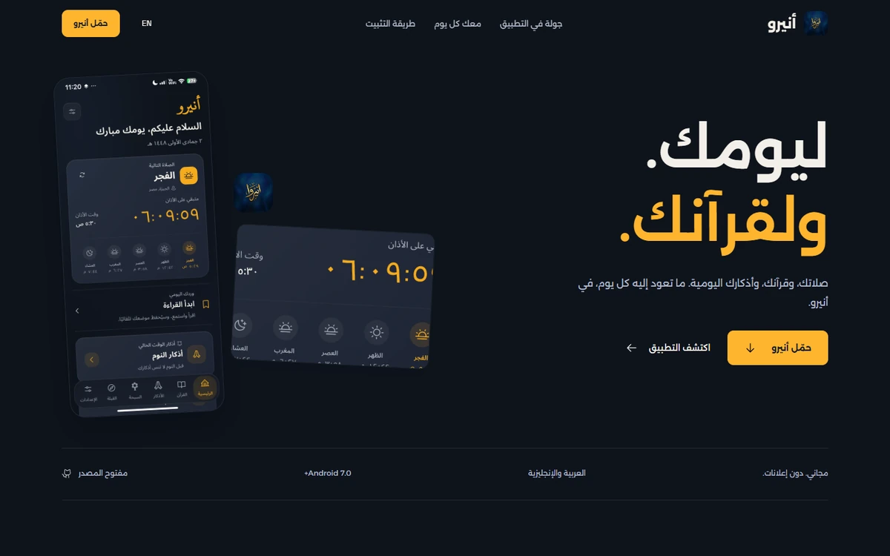
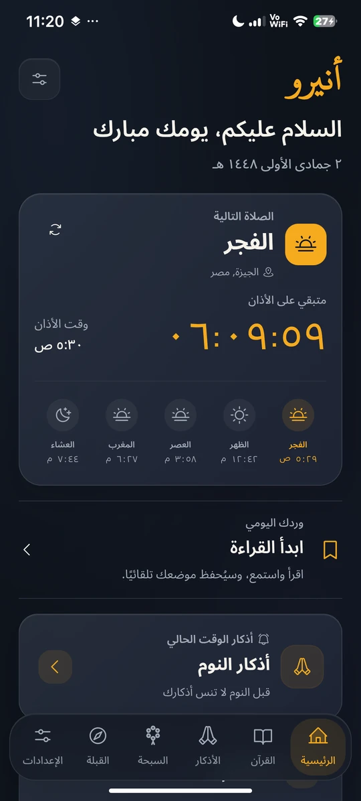
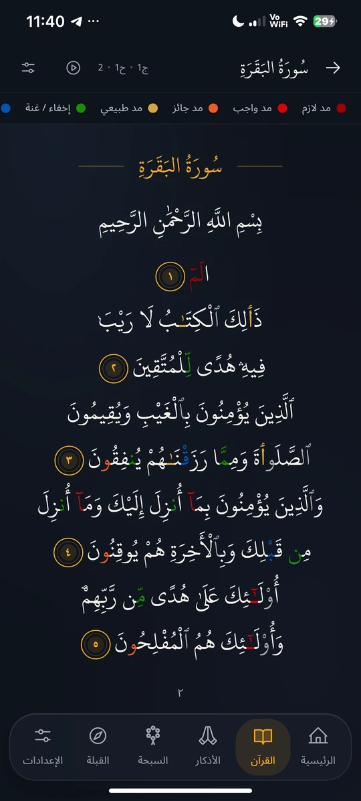
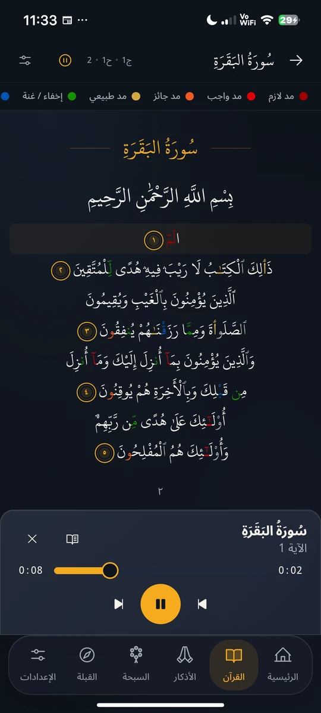
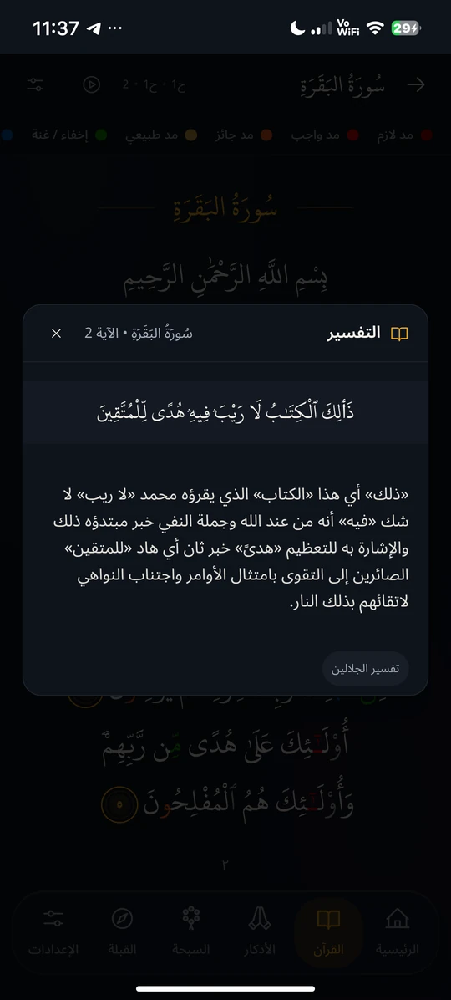
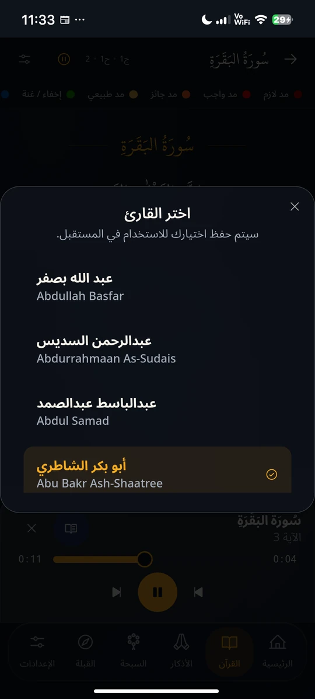
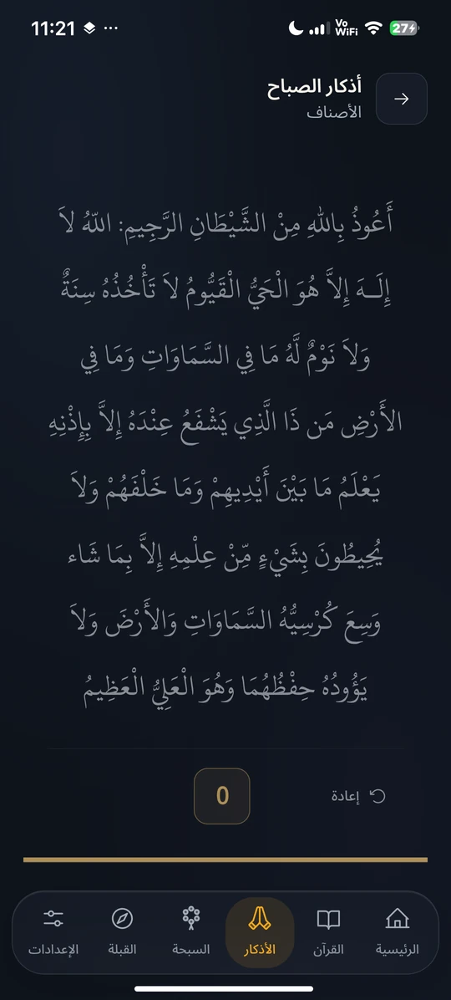
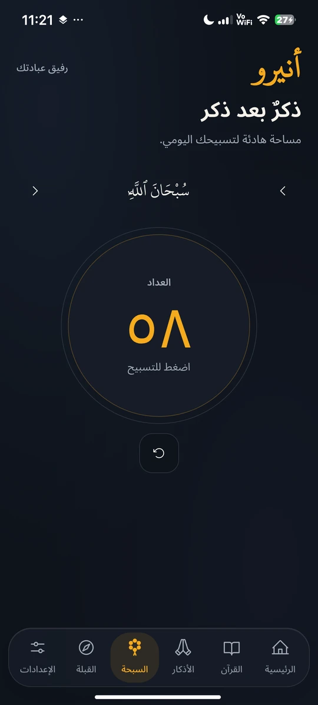
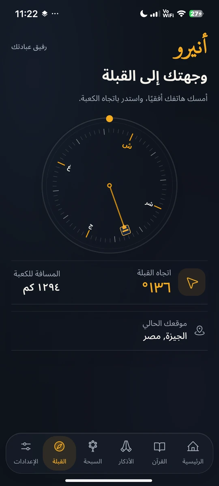

  
  <h1>Aniro website</h1>
  
صلاتك، قرآنك، وذكرك. أقرب، كل يوم.

  
<a href="https://aniro.vercel.app/">Live website</a> · <a href="https://github.com/its3li/Aniro/releases/latest">Official Android download</a> · <a href="https://github.com/its3li/Aniro">App repository</a>

The official Arabic-first website for Aniro. English is available through
the language control. The site uses the current app logo and genuine phone
captures, with no embedded videos.

## Current app screens

These are the same current assets used by the website, rather than the
older screenshots from the previous interface.

| Home | Quran | Listening | Tafseer |
| --- | --- | --- | --- |
|  |  |  |  |

| Arabic reciter names | Daily Azkar | Tasbeeh | Qibla |
| --- | --- | --- | --- |
|  |  |  |  |

Capture provenance is in [SOURCES.md](assets/screens/SOURCES.md). Original
screens are 1080 × 2392; full WebP images retain that aspect ratio. Exact
detail crop bounds are in [DETAIL-SOURCES.json](assets/screens/DETAIL-SOURCES.json).
The app UI, Quran text, counters, and compass state are not fabricated.

The gallery shows each screen with its own caption. On smaller screens,
native scrolling and arrow controls let visitors browse the complete views.

## Website behavior

- Arabic/English content and layout direction, saved in the browser.
- An open Quran screenshot gallery with native touch scrolling and keyboard
  controls. No feature tabs or one-image substitution panel.
- Official APK links, live release metadata, and a verified local fallback.
- Clear installation and upgrade instructions for new and existing users.
- Mobile navigation, visible focus, and reduced-motion support.
- Local fonts, Phosphor icons, optimized images, and privacy information.
- No embedded videos or external styling runtime.

## Local development

This is a static HTML/CSS/JavaScript site. Node.js is only needed for the
local preview helper; no frontend package installation or build step is
required.

    git clone https://github.com/its3li/Aniro-Landingpage.git
    cd Aniro-Landingpage
    node scripts/serve.cjs

Open http://127.0.0.1:3320. The established main branch deploys through
Vercel at https://aniro.vercel.app.

## Files

| File | Purpose |
| --- | --- |
| index.html | Product, screenshot gallery, and download content |
| styles.css | Whole-page responsive brand layout |
| app.js | Language, gallery navigation, mobile menu, and release feed |
| privacy.html | Existing service and permission information |
| release.json | Last verified official release metadata |
| assets/ | Current logo, screenshots, exact crops, fonts, and icons |
| DESIGN.md | Design direction and pre-flight decisions |
| scripts/qa.cjs | Viewport, gallery, language, media absence, and fallback checks |

## Validation and assets

QA uses the adjacent Aniro workspace's Playwright dependency and configured
Chromium executable. It checks both languages at five viewport widths,
including gallery arrows and keyboard behavior, image proportions, download
URLs, reduced motion, and fallback states. Reports and screenshots go to
the ignored .codex-run directory.

Alexandria and Space Grotesk licenses accompany their local font files.
Phosphor icons include their license. The unchanged app logo is resized
for web delivery. Assets in this README are committed locally so GitHub
can render them without depending on the deployed site.

Built by [Ali Mahmoud](https://github.com/its3li).
